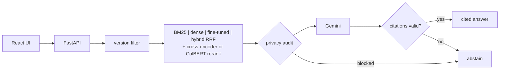
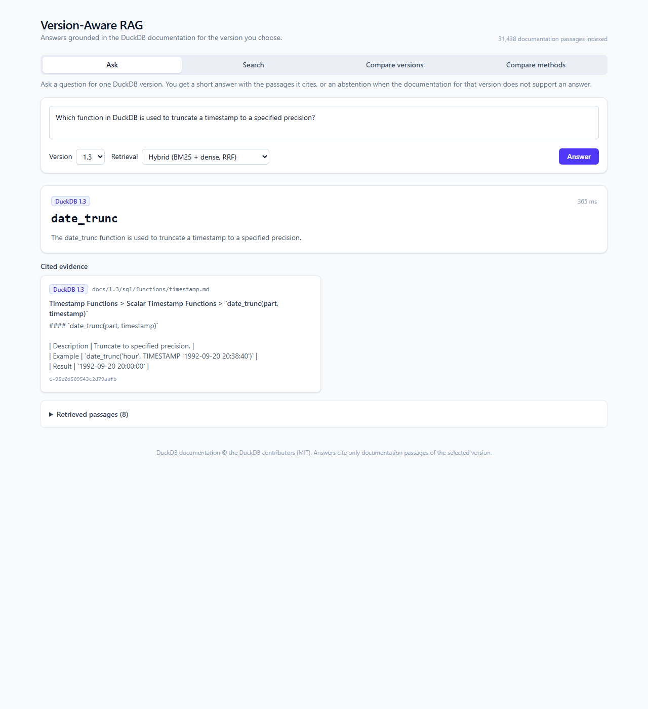
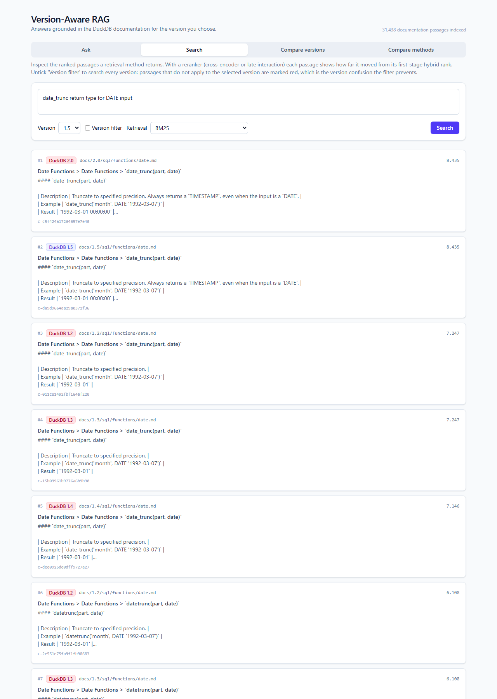

# Version-Aware RAG

Retrieval-augmented question answering over five versions of the DuckDB documentation, with a
benchmark and an evaluation harness that measure whether a retriever returns evidence for the
**version the user asked about**.

## Why version awareness matters

Documentation changes between releases, but most of it does not. In the pinned DuckDB docs, 66–79%
of shared pages are identical or nearly identical between consecutive versions from 1.2 to 1.5
([research evidence](docs/design/RAG-M1_research_evidence.md) §3.4). A retriever that ignores
versions can therefore return a passage that was true for 1.4 when the user asked about 2.0, and an
answer pipeline can cite it confidently. Public RAG benchmarks rarely measure this failure directly.

**Research question:** when documentation changes across versions, do retrievers return outdated
or conflicting evidence? Which methods retrieve the correct version-specific evidence, and can an
answer pipeline cite it or abstain correctly?

## What is implemented

| Component | What it does | Status |
|---|---|---|
| Corpus pipeline | Pinned DuckDB docs 1.2, 1.3, 1.4 LTS, 1.5 and 2.0 (31,438 retrievable chunks), parsed and chunked deterministically; the committed manifests rebuild byte for byte | Implemented; rebuilt from a fresh clone |
| Benchmark | Five question types (stable, version-specific, change-introduced, multi-hop, unanswerable), qrels anchored to verbatim evidence spans, automatic version-confuser hard negatives | Implemented; 52-record pilot reviewed, 40 retained, frozen into dev 15 / test 25 |
| Retrieval | BM25, dense (`bge-small-en-v1.5` + FAISS), hybrid RRF, cross-encoder reranking, ColBERT-style late-interaction reranking, each with and without a metadata version filter | Implemented and evaluated |
| Fine-tuned embedder | Hard-negative training-data pipeline with leakage checks, Colab notebook, model validation | Implemented and tested; **no model trained, not evaluated** |
| Answering | Gemini answers grounded in retrieved passages, with citation checks, abstention and a fail-closed privacy audit | Implemented and evaluated |
| Citation support | Local NLI scoring of citation support and faithfulness | Implemented; **threshold uncalibrated** |
| Evaluation gate | Deterministic regression gate for pull requests (seeded bootstrap, fixed outcome table) | Implemented; demonstrated locally; **CI job dormant** |
| Application | FastAPI backend and React UI (ask, search, compare versions, compare methods), Docker Compose | Implemented; run from a fresh clone |

## Architecture



The offline pipeline, evaluation flow and privacy boundary are diagrammed in
[`docs/architecture.md`](docs/architecture.md); the design is
[`docs/design/RAG-M1_design.md`](docs/design/RAG-M1_design.md).

| Directory | Contents |
|---|---|
| `src/version_aware_rag/` | Library and `vrag` CLI: `corpus/`, `benchmark/`, `evidence/`, `probes/`, `retrieval/`, `answer/`, `api/` |
| `frontend/` | React + TypeScript + Vite + Tailwind UI |
| `benchmark/` | Protocol, change inventory, review records and the frozen `splits/` |
| `data/manifest/`, `data/evidence/` | Committed corpus manifests (metadata only) and probe observations |
| `configs/` | Corpus, chunking, drafting, probe and gate configuration |
| `docs/` | Design, technical report, architecture, limitations, benchmark datasheet, screenshots |
| `tests/` | Unit, smoke and real-corpus integration tests |

## Technology

- **Python 3.12**, uv, Pydantic, FastAPI, pytest, ruff, mypy (strict), GitHub Actions
- **Retrieval:** bm25s, Sentence-Transformers, FAISS (CPU), PyTorch (CPU only), transformers
- **Models:** `BAAI/bge-small-en-v1.5`, `cross-encoder/ms-marco-MiniLM-L-6-v2`,
  `lightonai/answerai-colbert-small-v1`, `cross-encoder/nli-deberta-v3-xsmall`
- **LLM:** Gemini (`gemini-3.5-flash-lite`) for benchmark drafting and answers; never in CI and never
  sent restricted text
- **Frontend and deployment:** React 18, TypeScript, Vite, Tailwind 4, Docker

## Screenshots

| Cited answer | Version confusion without the filter |
|---|---|
|  |  |

More in [`docs/screenshots/`](docs/screenshots): abstention, reranking inspection, version and
method comparison, error state and mobile layout.

## Quickstart

Requirements: git, [uv](https://docs.astral.sh/uv/) 0.13.9 (it installs Python 3.12), and Node 24
with npm 11 for the UI. No GPU is needed. If `uv` is not on PATH (common on Windows), use
`python -m uv` instead.

```bash
git clone <repo-url> version-aware-rag && cd version-aware-rag
uv sync --locked
uv run vrag corpus fetch && uv run vrag corpus releases fetch   # network; pinned sources
uv run vrag corpus build                                        # deterministic chunks
uv run vrag index build --methods bm25,dense                    # CPU; downloads bge-small once
(cd frontend && npm ci && npm run build)
uv run vrag serve                                               # http://127.0.0.1:8000 (API docs at /docs)
```

Or, after the corpus and index steps: `docker compose up --build` (binds to 127.0.0.1:8000).

**Configuration.** Settings come from `VRAG_` environment variables or a git-ignored `.env`
([`.env.example`](.env.example)). Search, version comparison and the UI need no key. The `/answer`
endpoint needs `VRAG_GEMINI_API_KEY` (server side only) and the locally fetched sources for its
privacy audit; without the key it returns 503.

**Tests.** `uv run ruff check . && uv run mypy && uv run pytest`. Without the corpus cache, the suite
reports 996 passed and 50 skipped: the skipped tests are the real-corpus tests, which need the
fetched and built corpus. After the fetch and build steps above, `uv run pytest -m corpus` runs all
50; the CI `corpus-rebuild` job requires them to run with zero skips.

Full step-by-step reproduction, with expected exit codes: [`REPRODUCE.md`](REPRODUCE.md).
Commands, CLI, API reference and deployment details: [`DEVELOPMENT.md`](DEVELOPMENT.md).

## Evaluation

**Method.** Retrieval is scored with Recall@5/10/20, MRR@10, nDCG@10, the version confusion rate
(VCR@10: the share of the top 10 from incompatible versions) and confuser@10, using graded qrels
built from evidence spans. Answers are scored with a deterministic matcher (no LLM grading), version
correctness, abstention precision and recall, and citation precision. Every method runs with and
without the version filter on the same harness; uncertainty is reported as paired cluster
bootstrap 95% CIs (10,000 resamples) with Holm correction for the comparisons against BM25.

**Results** on the frozen test split (25 items; retrieval on the 22 answerable items; full tables in
the [technical report](docs/reports/RAG_technical_report.md) §7). Version-filtered runs:

| Method | Recall@10 | MRR@10 | nDCG@10 | p50 latency (CPU) |
|---|---|---|---|---|
| BM25 | 0.682 | 0.575 | 0.465 | 1 ms |
| Dense (bge-small) | 0.591 | 0.467 | 0.410 | 20 ms |
| Hybrid RRF | 0.693 | 0.556 | 0.463 | 26 ms |
| Hybrid + cross-encoder | 0.727 | 0.592 | 0.466 | 4.7 s |
| Hybrid + ColBERT MaxSim | 0.818 | 0.509 | 0.473 | 6.5 s |

- **The version filter removes version confusion.** Without it, 70–75% of every method's top 10
  comes from incompatible versions, and 13–19% are version-confuser chunks of the very page and
  section holding the answer. The filter brings both to 0 and raises MRR@10 by 0.21–0.25 for every
  method (BM25: 0.343 to 0.575). The filter comparison itself is not significance-tested.
- **No method differs significantly from filtered BM25** after Holm correction over 24 comparisons.
  Late interaction has the highest filtered Recall@10 (difference 0.136, 95% CI [-0.079, 0.341]),
  at several seconds per query on CPU.
- **Answers** (version-filtered hybrid, cached Gemini responses for 22 of 25 items): accuracy 0.789
  on answerable items (15 of 19 correct; the other 4 abstained, and no answered question was wrong),
  citation precision 0.90, abstention recall 1.00 with precision 0.43. Citation support and
  faithfulness (local NLI, uncalibrated) are 0.633 on 16 sentences.
- **Error analysis** (author-reviewed): 103 retrieval failures across all methods and filter modes
  (lexical miss 42, wrong section 23, wrong version 20, chunk split 12, missing hop 6). All 20
  wrong-version failures occur without the filter
  ([error review](docs/reports/M8_owner_error_review.md)).

## Limitations

- **Small benchmark:** 52 reviewed items, 40 retained (test 25, dev 15). Confidence intervals are
  wide, and the multi-hop and unanswerable types are below their protocol targets. The items were
  drafted with Gemini and reviewed by the author with AI assistance, so the labels are not an
  independent human annotation.
- **Fine-tuned embedder not trained:** the pipeline is implemented and tested, but no model was
  trained, so five of the six retrieval methods have results.
- **NLI threshold uncalibrated:** citation-support and faithfulness scores use an uncalibrated
  threshold (no labelled calibration set).
- **Evaluation gate dormant:** the gate is demonstrated locally on the pre-review pilot only. It is
  not enforced in CI, because there is no separate gate split and no approved baseline.
- **Coverage and scoring:** answer results cover 22 of 25 test items (3 had no cached response);
  answer accuracy is a strict lower bound (only reviewed aliases are accepted).
- **Scope:** late interaction reranks the hybrid top 100 rather than searching a full token-level
  index; release notes and posts are never sent to the model, so changelog evidence is not used for
  answering; local Docker is the only deployment, with no authentication or rate limiting.

Full list: [`docs/LIMITATIONS.md`](docs/LIMITATIONS.md).

## Documentation

| Document | Contents |
|---|---|
| [`REPRODUCE.md`](REPRODUCE.md) | Every step from a fresh clone to the reported numbers |
| [`docs/reports/RAG_technical_report.md`](docs/reports/RAG_technical_report.md) | Method, full results with CIs, error analysis and the evaluation gate |
| [`docs/LIMITATIONS.md`](docs/LIMITATIONS.md) | Scope decisions and limitations |
| [`docs/benchmark/datasheet.md`](docs/benchmark/datasheet.md) | Benchmark datasheet: composition, review and splits |
| [`docs/architecture.md`](docs/architecture.md) | Architecture diagrams |
| [`docs/design/RAG-M1_design.md`](docs/design/RAG-M1_design.md) | Design: hypotheses, benchmark protocol and evaluation plan |
| [`docs/reports/P2_FINAL_ACCEPTANCE_AUDIT.md`](docs/reports/P2_FINAL_ACCEPTANCE_AUDIT.md) | Requirement-by-requirement evidence |
| [`DEVELOPMENT.md`](DEVELOPMENT.md) | Commands, CLI, API reference, corpus and CI details |

## About this repository

This public repository is a single-snapshot release of the project, published as one initial
commit. Development took place in a private repository whose history is not published, so the
commit hashes, pull-request numbers, CI-run links and decision ids (`Dnn`) cited in the documentation
refer to that private history and to the author's private project log.

**AI assistance.** Parts of the code and documentation were written with AI coding assistants under
the author's direction. The benchmark items were drafted with the Gemini API and then reviewed by
the author. The author directed the design and made every review and acceptance decision; the
reported numbers come from the evaluation commands documented here.

## License

The project's own code and documentation are released under the [MIT License](LICENSE).
Third-party material, including the DuckDB documentation excerpts and DuckDB output, keeps its
original licence and copyright; models are downloaded at run time under their own licences. See
[`THIRD_PARTY_NOTICES.md`](THIRD_PARTY_NOTICES.md).
