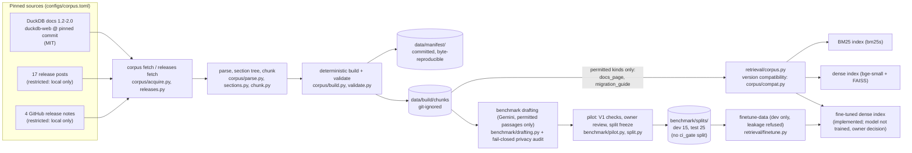
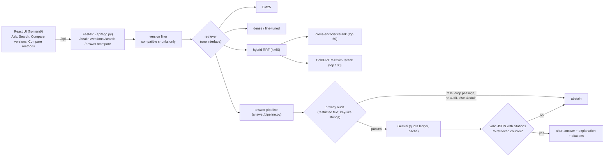
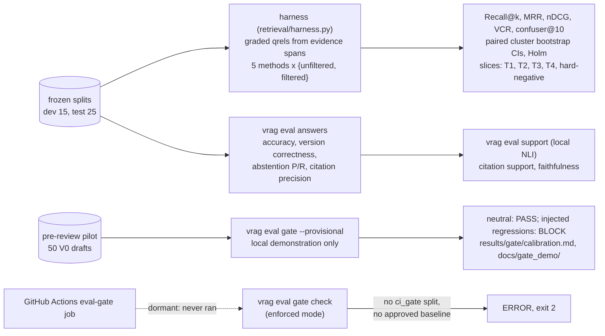

# Architecture

The approved design is [`design/RAG-M1_design.md`](design/RAG-M1_design.md). These diagrams show what is
implemented in this repository. Every box names the module that implements it.

## 1. Offline: corpus, indexes and benchmark

## 2. Online: query to cited answer

## 3. Evaluation and the CI gate

Gate state (owner decision, small-pilot scope): the gate logic (`retrieval/gate.py`,
`gate_commands.py`) is implemented and tested, but there is **no separate ci-gate split**, **no
approved baseline** (`configs/gate.toml` has an empty `baseline_sha256`), and the **CI job is
dormant**. The gate was demonstrated only on the pre-review pilot; its tolerances are uncalibrated
design defaults. Since the freeze, the `--provisional` dry run would evaluate the frozen test
split's items, so it is not re-run; the pilot commands are a historical record (`REPRODUCE.md` §6).

## 4. Privacy boundary

Release-post and release-note text is restricted (licence not established). It is fetched and
hash-verified locally, used only for the fail-closed audit that runs before any external request,
and kept in git-ignored paths (`data/cache/`, `data/evidence/local/`). It is never indexed for
retrieval, never sent to Gemini or any other service, never committed, and never copied into the
Docker image (`.dockerignore`).
